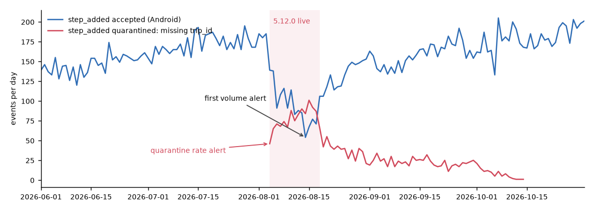

# Governed event pipeline for a travel app

A first data hire's foundation for a Polarsteps style app, built end to end on synthetic data: a **tracking plan as code** that gates every app event, **privacy treatment before anything lands** (pseudonymized ids, contact details redacted, home locations removed), a **dbt source of truth** with contracts and ownership, monitoring that catches a bad app release on day one, attribution that accounts for SKAN, and **Claude as an analyst** that can only see governed marts.

`python run_all.py` runs everything in about 2 minutes on a laptop (DuckDB stands in for the warehouse).

## Results

| Question | Answer |
|---|---|
| Does the gate catch bad tracking? | **10,670 of 10,752** planted problems handled (99.2%). The 82 misses are one known gap: phone numbers spelled out in words. |
| Can someone find a traveler's home from step locations? | Raw data: **82.8%** of 7,411 travelers located within 1 km. Warehouse: **0%**. |
| What does privacy cost analytics? | 20.8% of steps lose coordinates (row and country kept). Trip distance error: median **0.28%**, p95 1.07%. |
| How fast is a broken release caught? | Android 5.12.0 dropped `trip_id`: quarantine rate alert on **day 1** (53% rejected). A volume alert would have waited **10 days**. |
| What does ignoring SKAN do to iOS CPI? | Meta reads **€4.40** per install instead of **€1.60**; iOS organic is overstated by **47%**. |
| Can Claude query safely? | Only 4 marts, read only, no file access, one SELECT, no row level keys, counts under 10 masked. Guard covered by tests. |



## Pipeline

```
raw app events (JSON)  ──►  gate.py  ──►  governed parquet  ──►  dbt (staging ► marts)  ──►  Metabase / Claude
AppsFlyer installs          │  tracking_plan.yml                     contracts, tests,            analyst.duckdb
SKAN postbacks              │  accept / repair / quarantine          exposures, owners            (marts only)
ad spend                    │  HMAC ids, redact, home zones
                            └► exports: Mixpanel (allowlisted props, country only), ad platforms (consented, hashed email)
```

| Step | What it does | File |
|---|---|---|
| Tracking plan | Every event, property, type, enum, owner, destination and **pii class** (`identifier`, `direct`, `free_text`, `location`) | `tracking_plan/tracking_plan.yml` |
| Gate | Dedupe on `event_id`; rename documented aliases; normalize enum case; clamp future device clocks; drop undeclared properties and log them; quarantine unknown events, missing required fields and type errors | `src/gate.py` |
| Privacy | `user_id`/`device_id` to keyed HMAC (rotatable, not reversible without the key); email and IP dropped (IP becomes country); emails and phones redacted from free text; step locations within 2 km of any trip start or end suppressed, the rest rounded to ~1 km | `src/gate.py` |
| Exports | Mixpanel gets only plan allowlisted, non sensitive properties; ad platforms get conversion events for consented users only, as SHA256 email | `data/exports/` |
| Schema change process | A tracking plan PR is classified additive, breaking or privacy review; CI fails the last two | `src/plan_diff.py`, `.github/workflows/ci.yml` |
| Modeling | Staging per event, marts `dim_travelers`, `fct_trips`, `fct_retention_weekly`, `fct_channel_performance`. Tier 1 marts have **enforced contracts**. Owners in `meta`, dashboards as **exposures** | `dbt/` |
| Tests | 27 dbt tests incl. privacy tests (no contact details, no precise or home coordinates, no raw ids) and a warn level quarantine rate check | `dbt/tests/` |
| Monitoring | Gate scorecard, quarantine rate per app version per day, volume vs trailing median, undeclared properties, storage | `src/health.py` → `reports/health_report.md` |
| Privacy test | Home inference attack on raw vs warehouse, plus utility loss | `src/privacy_eval.py` |
| Claude analyst | Tool use loop over `analyst.duckdb` with guardrails in code, schema docs taken from the dbt yml | `src/ask.py` |

## What I'd tell the team

1. **Page on rejection rate by app version, not on volume.** Releases roll out gradually, so the trailing median falls with them. The 5.12.0 bug was 53% of that version's events on day 1, but total `step_added` volume only crossed the 50% line on day 10.
2. **Quarantine, don't drop.** 2,428 broken steps are kept (redacted) so they can be replayed once `trip_id` is backfilled from `step_id`. Users who never updated keep sending them for weeks.
3. **Location is the most sensitive thing a travel app holds.** Trip starts and ends give away home for 4 in 5 travelers. Removing coordinates near those points costs almost nothing for trip analytics because the row and country stay.
4. **iOS attribution needs SKAN in the model.** Without it, paid iOS looks 2.5x to 3x more expensive than it is and word of mouth looks bigger than it is. That changes budget decisions.
5. **Undeclared properties are a process signal.** iOS 7.3.0 started sending `ai_caption` (2,427 events). The gate drops it and the fix is a one line plan PR, which `plan_diff` passes as additive: `tracking_plan/proposals/01_add_ai_caption.yml`. A marketing request to send step locations to ad platforms (`02_geo_audiences.yml`) is blocked for privacy review.
6. **LLMs on company data: safety by construction.** The model gets a separate database file with marts only, opened read only with external access off. Prompt rules are a second line, not the first.

## Schema change process in practice

```
$ python src/plan_diff.py tracking_plan/tracking_plan.yml tracking_plan/proposals/02_geo_audiences.yml
[breaking] travel_book_ordered.price_eur removed
[breaking] travel_book_ordered.currency added (required, pii none)
[breaking] travel_book_ordered.price added (required, pii none)
[privacy_review] step_added: new destination ad_platforms
[privacy_review] step_added.lat pii location -> none
[privacy_review] step_added.lon pii location -> none
exit 1
```

## Run it

```bash
pip install -r requirements.txt
python run_all.py                      # generate, gate, dbt build, privacy eval, health report, analyst db
pytest -q                              # 18 tests
python src/ask.py --sql "select platform, count(*) as n_travelers, avg(activated_7d::int) from dim_travelers group by 1"
python src/ask.py "Which iOS channel has the lowest cost per signup since July?"   # needs ANTHROPIC_API_KEY
```

Set `PSEUDO_KEY` outside a demo. Each `run_all.py` step is a plain function, so it maps one to one onto Dagster assets or Airflow tasks; dbt runs unchanged on BigQuery, Snowflake or ClickHouse with a different profile.

## Data and limits

Synthetic: 20,000 installs (55% iOS, 52% organic), 14,428 signups, 8,963 trips, 163,533 raw events, January to October 2026. Problems are planted with ground truth labels (`data/raw/truth.csv`) so the gate can be scored. Homes and trips are generated, so the 0% re-identification result shows the policy works for the pattern it targets (start and end of trips); a traveler who logs steps near home mid trip, or a stronger attacker using suppression patterns, would need the policy re-tested. The regex redactor misses obfuscated contact details by design of this test.
