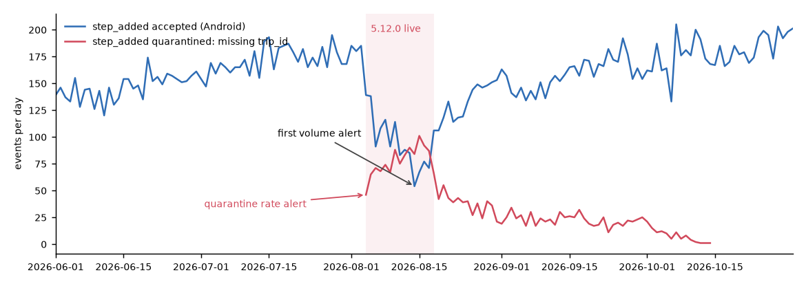

# Data stack health report

Raw events **163,533**, accepted **158,306**, quarantined **2,811**, duplicates dropped **2,416**.
dbt build: no-op 3, pass 16, success 11, warn 1.

## 1. Gate scorecard (planted problems vs what the gate did)

| planted problem | events | handled | rate | action |
|---|---|---|---|---|
| duplicate | 2,416 | 2,416 | 100% | dropped (same event_id) |
| legacy_name | 856 | 856 | 100% | renamed via plan alias |
| enum_case | 1,084 | 1,084 | 100% | normalized via plan rule |
| future_timestamp | 574 | 574 | 100% | clamped to received time |
| undeclared_property | 2,405 | 2,405 | 100% | property dropped, flagged for a plan PR |
| pii_email | 349 | 349 | 100% | redacted |
| pii_phone | 175 | 175 | 100% | redacted |
| pii_obfuscated | 82 | 0 | 0% | not caught: phone number spelled out in words (known regex gap) |
| missing_required | 2,428 | 2,428 | 100% | quarantined |
| type_error | 63 | 63 | 100% | quarantined |
| unknown_event | 320 | 320 | 100% | quarantined |

## 2. What broke in production

Android 5.12.0 (live 4 Aug) dropped `trip_id` from `step_added`. The gate quarantined those events instead of loading orphan steps. The quarantine rate monitor (per app version, per day) fired on **04 Aug** (53% of that version's events rejected). A plain volume monitor only fired on **14 Aug** (accepted volume 47% of the trailing 14 day median), because users roll onto a release gradually and the median drifts down with them. Volume alerts alone are too slow for staged app releases; rejection rate by app version is the signal to page on. Users who never updated past 5.12.0 keep sending broken events after the fix: the quarantine keeps them for replay once the app team backfills `trip_id` from `step_id`.

Quarantine rate alerts (all versions, more than 5% rejected on a day with 20+ events):

| platform | app_version | first_alert | alert_days | rate_on_first_day |
|---|---|---|---|---|
| android | 5.12.0 | 2026-08-04 | 61 | 0.529 |
| android | 0.0.0-qa | 2026-09-20 | 7 | 1.0 |

Top quarantine sources:

| platform | app_version | reason | n |
|---|---|---|---|
| android | 5.12.0 | missing_required:trip_id | 2,428 |
| android | 0.0.0-qa | unknown_event | 320 |
| android | 5.11.3 | type_error:price_eur | 63 |

Undeclared properties (accepted, property dropped; needs a tracking plan PR before it can reach the warehouse):

| property | events |
|---|---|
| ai_caption | 2,427 |

## 3. Privacy

Home location found within 1 km by a simple attack (most visited place, or first trip start): **82.8%** of 7,411 travelers on raw data, **0.0%** on the warehouse. Cost: 20.8% of steps lose coordinates (rows and countries kept); trip distance error median 0.28%, p95 1.07%. Mixpanel receives country only; ad platforms receive hashed email for consented users only.

## 4. Attribution: iOS paid channels with and without SKAN

| channel | spend_eur | installs_reported | installs_with_skan | cpi_reported | cpi_with_skan |
|---|---|---|---|---|---|
| apple_search_ads | 2,517 | 907 | 907 | 2.78 | 2.78 |
| meta_ads | 2,310 | 525 | 1,444 | 4.4 | 1.6 |
| google_ads | 2,240 | 405 | 1,061 | 5.53 | 2.11 |
| influencer | 1,062 | 351 | 1,062 | 3.03 | 1.0 |
| tiktok_ads | 917 | 263 | 766 | 3.49 | 1.2 |
| organic | 0 | 8,621 | 5,853 | 0.0 | 0.0 |

iOS installs without ATT consent show up as organic at user level. Reading CPI from the user level report alone overstates iOS paid CPI and credits paid installs to word of mouth. `fct_channel_performance` moves SKAN installs back.

## 5. Storage (cost proxy)

| table | rows | columns |
|---|---|---|
| staging.stg_events | 158,306 | 10 |
| staging.stg_step_added | 84,655 | 13 |
| staging.stg_other_events | 50,260 | 10 |
| staging.stg_installs | 20,000 | 8 |
| marts.dim_travelers | 14,428 | 13 |
| staging.stg_user_signed_up | 14,428 | 7 |
| marts.fct_trips | 8,963 | 16 |
| staging.stg_trip_created | 8,963 | 8 |
| staging.stg_marketing | 4,036 | 7 |
| marts.fct_retention_weekly | 499 | 5 |
| marts.fct_channel_performance | 114 | 13 |

Governed parquet (MB): ad_spend.parquet 0.03, events.parquet 8.6, gate_log.parquet 0.25, installs.parquet 0.95, quarantine.parquet 0.13, skan_postbacks.parquet 0.01
